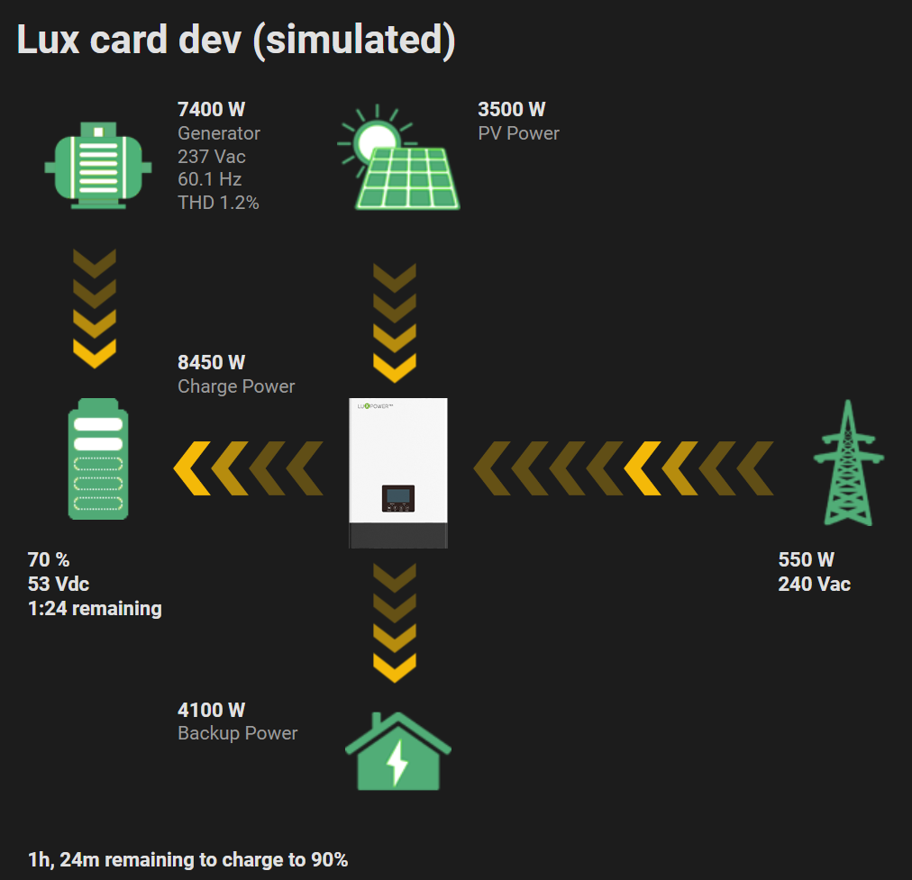
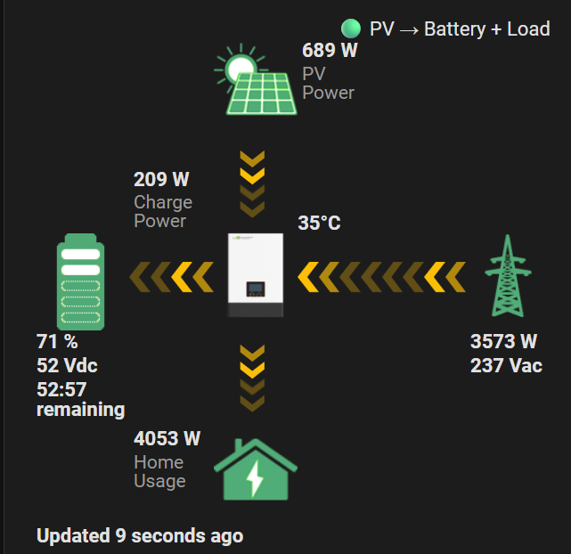

# LuxPower Distribution Card

> **Fork of [DanteWinters/lux-power-distribution-card](https://github.com/DanteWinters/lux-power-distribution-card)** adding a DC-coupled generator (charging the batteries directly, with the grid still shown), operating-mode and fault/warning status, entity-based depth of discharge and optional feed spacing; existing configs look and work as before. See [Fork changes](#fork-changes).

A simple power distribution card of an inverter and battery system, for [Home Assistant](https://home-assistant.io/). The card is modelled after LuxpowerTek's app and website.

## Fork changes

All additions are optional; a config without them renders exactly like upstream. Details are in the [config](/docs/config/config.md) document.

- **`generator`** with `architecture: battery` draws a generator that charges the batteries directly on the DC bus (through its own chargers and the BMSs, not the inverter). It sits above the battery with an animated feed and appears only while running (power above a threshold, or forced on by a `running_entity`). It shows power plus optional voltage, frequency and THD, and its power is added to the battery flow. The grid stays visible. `architecture: grid` gives upstream's original behaviour, where the generator replaces the grid.
- **`status_codes.show_operating_mode`** names the operating mode (e.g. `PV → Battery + Load`) instead of "Normal"; **`fault_entities`** / **`warning_entities`** show non-zero fault and warning codes as red/orange lines.
- **`battery.depth_of_discharge`** also accepts an entity (e.g. the inverter's cut-off SOC setting) or one per inverter.
- **`feed_spacing: true`** leaves a gap between the PV/home feeds and their icons.
- Fixes: a non-numeric SoC shows `—` instead of `NaN`; runtime minutes are zero-padded (`1:05`, not `1:5`).

 

## Installation

### HACS

This card has been added to the list of default HACS frontend elements. Search for the name on HACS, and download from there to install.

## Adding the card to the dashboard

Currently, the UI editor does not work. The only way to add the card is to add the `yaml` code. There are examples in [config](/docs/config/config.md) document.

## LuxpowerTek integration

The LuxpowerTek integration is hosted in a private repository by [Guy Wells](https://github.com/guybw).

## Refresh and the Dongle serial number

This refresh only works for the LuxPowerTek integration referenced above. The service name and function call format are hard-coded.

The location of the refresh button can be set with the *refresh_button_location* config value. There are 4 accepted values for this config:

- left (Displayed on the left hand side, below the battery text.)
- right (Displayed on the right hand side, above the grid image.)
- both (Displayed on both sides, as described on the above two points.)
- none (Removes the refresh button.)

## Allocated power entity

The *allocated_power_entity* is an entity for allocated power in your house. It is a helper group of summed entities, that allow you to see how much of your power is assigned to devices. The reason this is a single grouped item, is because then it works well with the history graph.

## Grid indicators

Below are 2 pictures of the grid image. The first is the grid in a normal state, and the second is the grid image with both indicators active.

| Normal Grid | No Grid Input |
|---|---|
|  |  |

## Gallery

| The card with only required entities | The card with all required and optional entities | The card using all the LuxPower integration options and entities |
|---|---|---|
|  |  |  |

## Interactive Card

Most of the images can be clicked to show the history of the entity. There are special configs for parallel inverters.

## FAQ's

The FAQ's can be found [here](/docs/FAQ.md).
