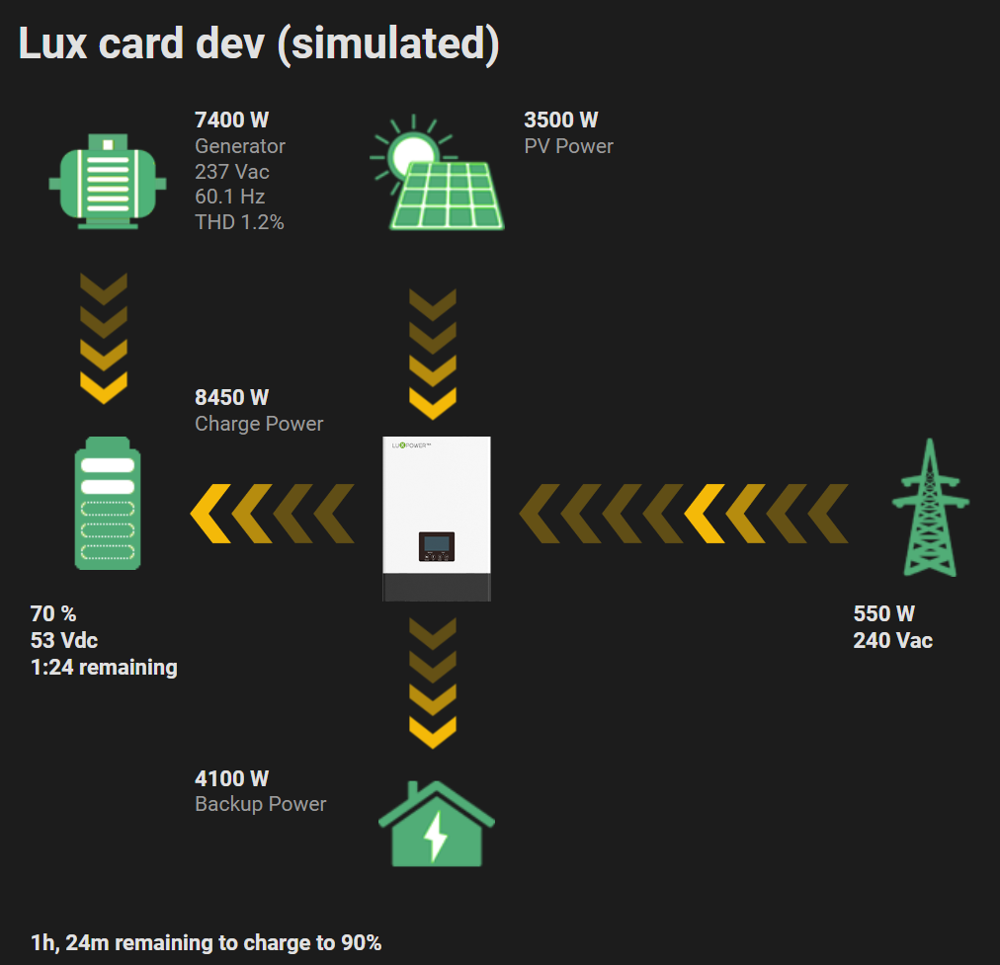
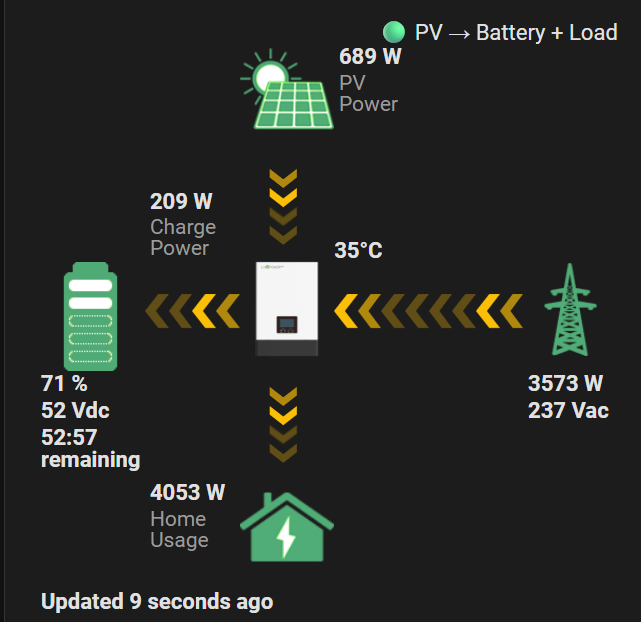

# Config

## Full config

The config has a series of nested objects in the config. Below is a all the highest level objects

```yaml
type: custom:lux-power-distribution-card
inverter_count: number # required
battery: nested object # required
parallel: nested object # optional
refresh: nested object # optional
grid: nested object # required
consumption: nested object # required
pv: nested object # optional
temp: nested object # optional
update_time: nested object # optional
status_codes: nested object # optional
title: string # optional
generator: nested object # optional (fork)
feed_spacing: boolean # optional (fork)

```

### `inverter_count`

The `inverter_count` is a required config. It must be a positive integer, and it indicates the number of inverters configured.

### `title`

Adds a title to the top of the card.

### `battery`

```yaml
battery:
    soc_entities: list of entities # required
    combined_soc_entity: entity # optional
    flow_entities: list of entities # conditionally required
    invert_flow: boolean # optional
    parallel_flow_entity: entity # optional
    discharge_live_entities: list of entities  # conditionally required
    combined_discharge_live_entity: entity # optional
    charge_live_entities: list of entities # conditionally required
    combined_charge_live_entity: entity # optional
    capacity_ah_entities: list of entities # optional
    voltage_entities: list of entities # optional
    parallel_average_voltage: boolean # optional
    runtime_location: string # optional
    depth_of_discharge: number, entity or list of entities # optional
    charge_target: number, entity or list of entities # optional
    parallel_soc_entity: entity # optional
    show_parallel_soc_entity: boolean # optional
```

| Config | Description |
|---|---|
| `soc_entities` | List of entities of the battery state-of-charge (SoC). |
| `combined_soc_entity` | An entity that indicated the combined SoC. Used when using multiple inverters for a history graph. |
| `flow_entities` | List of entities of the battery flow. This is when charge and discharge is combined in one entity, where  positive value is charge and negative is discharge. This is required, if `discharge_live_entities` and `charge_live_entities` are not used. |
| `invert_flow` | When using the `flow_entities` to indicate battery flow, this flips charge and discharge. |
| `parallel_flow_entity` | An entity that indicates the combined flow. Used when using multiple inverters for a history graph. |
| `discharge_live_entities` | List of entities of the battery discharge. This is required along with `charge_live_entities` if `flow_entities` is not used. |
| `combined_discharge_live_entity` | An entity that indicated the combined discharge. Used when using multiple inverters for a history graph. |
| `charge_live_entities` | List of entities of the battery charge. This is required along with `discharge_live_entities` if `flow_entities` is not used. |
| `combined_charge_live_entity` | An entity that indicated the combined charge. Used when using multiple inverters for a history graph. |
| `capacity_ah_entities` | List of entities of the battery capacity. Used to calculate the battery runtime remaining. |
| `voltage_entities` | List of entities of the battery voltage. |
| `parallel_average_voltage` | This is used when there are parallel inverters, it will average the voltages when _parallel_ is selected. Otherwise the voltage will not be show when _parallel_ is selected. |
| `runtime_location` | Can be `left`, `bottom`, or `both`. If `capacity_ah_entities` and `voltage_entities` are used, the remaining battery runtime will be calculated: while discharging, the time down to `depth_of_discharge`; while charging, the time up to `charge_target`. Without `runtime_location`, neither estimate is shown. |
| `depth_of_discharge` | Used when the runtime is calculated: how far (%) the battery is set to discharge. A number (default 20), an entity whose state is the percentage (e.g. the inverter's cut-off SOC setting), or a list of entities, one per inverter (the parallel view uses the first). Falls back to 20 when the value isn't numeric. |
| `charge_target` | Used when the runtime is calculated while charging: the SoC (%) the "remaining to charge to" estimate counts up to. Takes the same forms as `depth_of_discharge`: a number (default 90), an entity (e.g. the inverter's charge SOC limit), or a list of entities, one per inverter. Values above 100 count as 100. Falls back to 90 when the value isn't numeric. |
| `parallel_soc_entity` | An entity with the combined SoC, used for the history graph and, with `show_parallel_soc_entity`, as the SoC shown in the parallel view. |
| `show_parallel_soc_entity` | Show `parallel_soc_entity` as the SoC in the parallel view instead of the average of `soc_entities`. |

### `parallel`

This is for when multiple inverters are configured. The card has no limit, but all entity lists must have the same numenr of items. When there are multiple inverters configured, there is a selector at the top left of the screen that can be used to select which inverter you want to show the info for. In the list, there is also an entry called **Parallel**. This will add or average all the values between te inverters.

```yaml
parallel:
    parallel_first: boolean # optional
    aliases: list of strings  # conditionally required
```

| Config | Description |
|---|---|
| `parallel_first` | Boolean. If `parallel_first` is true, the **Parallel** option in the selector will be shows first and be the default view, otherwise it will be last. |
| `aliases` | This is the aliases for the different inverters and how they will be identified on different places. This or the `lux_dongles` list in `refresh` is required. |

### `refresh`

```yaml
refresh:
    lux_dongles: list of strings # conditionally required
    button_entities: list of entities # optional
    parallel_button_entity: entity # optional
    button_location: string # optional
```

| Config | Description |
|---|---|
| `lux_dongles` | List of inverter serial numbers that is used for the refresh button, or as the indicators when there are multiple. This or the `aliases` in `parallel` is requried when using multiple inverters. |
| `button_entities` | Button entities to press when the refresh button is clicked, one per inverter (same order as the inverters), for integrations that expose a refresh button rather than the LuxpowerTek service. Example: EG4 Web Monitor's `button.<model>_<serial>_refresh_data`. The parallel view presses all of them, or `parallel_button_entity` if set. Can be used with or without `lux_dongles`. |
| `parallel_button_entity` | A single button entity pressed in the parallel view instead of every `button_entities` entry, e.g. EG4 Web Monitor's `button.parallel_group_a_refresh_data`. |
| `button_location` | The location of the refresh button. Can be `left`, `right` or `both`. |

### `grid`

```yaml
grid:
    flow_entities: list of entities # required
    parallel_flow_entity: entity # optional
    invert_flow: boolean # optional
    voltage_entities: list of entities # optional
    indicators: # optional
        hue: boolean # optional
        dot: boolean # optional
    generator_power_entities: list of entities # optional
    generator_voltage_entities: list of entities # optional
    parallel_average_voltage: boolean # optional
```

| Config | Description |
|---|---|
| `flow_entities` | List of entities of the grid flow. |
| `parallel_flow_entity` | An entity that indicated the combined grid flow. Used when using multiple inverters for a history graph. |
| `invert_flow` | Flips grid flow by multiplying by `-1`. |
| `voltage_entities` | List of entities of the grid voltage. This is also used to indicate if there is no grid. |
| `indicators.hue` | If set and the grid voltage drops to 0, the grid image will become dimmer. (Requires the `voltage_entities`.) |
| `indicators.dot` | If set and the grid voltage drops to 0, a red indicator will be added next to the grid voltage text. (Requires the `voltage_entities`). |
| `generator_power_entities` | List of entities of the generator power. |
| `generator_voltage_entities` | List of entities of the generator voltage. This is also used to indicate if there is no grid. |
| `parallel_average_voltage` | This is used when there are parallel inverters, it will average the voltages when _parallel_ is selected. Otherwise the voltage will not be show when _parallel_ is selected. |

### `consumption`

```yaml
consumption:
    home_entities: list of entities # required
    combined_consumption_entity: entity # optional
    backup_entities: list of entities # optional
    allocated_power_entity: entity # optional
```

| Config | Description |
|---|---|
| `home_entities` | List of entities for the home consumption. |
| `combined_consumption_entity` | This is used when there are parallel inverters, it will combine the home consumption when parallel is selected. |
| `backup_entities` | List of entities for the backup consumption. This is used when there is no power to the home consumption entities and the grid voltage is 0. |
| `allocated_power_entity` | Optional entity for power allocated to a device, shown on its own branch beside the home. |

### `pv`

```yaml
pv:
    combined_entities: list of entities # conditionally required
    combined_parallel_entity: entity # optional
    array_1_entities: list of entities # conditionally required
    array_2_entities: list of entities # optional
    array_3_entities: list of entities # optional
```

| Config | Description |
|---|---|
| `combined_entities` | List of entities of the solar power. This combined list will show one value per inverter, or  acombined value on parallel. |
| `combined_parallel_entity` | An entity that indicated the combined solar power. Used when using multiple inverters for a history graph. |
| `array_1_entities` | List of entities of the individual solar array. |
| `array_2_entities` | List of entities of the individual solar array. |
| `array_3_entities` | List of entities of the individual solar array. |

### `temp`

```yaml
temp:
    entities: list of entities # optional
```

| Config | Description |
|---|---|
| `entities` | List of entities of the temperature of the inverters. |

### `update_time`

```yaml
update_time:
    entities: list of entities # optional
    show_datetime: boolean # optional
    show_time_since: boolean # optional
    has_timestamp_attribute: boolean # optional
```

| Config | Description |
|---|---|
| `entities` | List of entities for the update times. |
| `show_datetime` | If set to true, the last updated time will show on the card. |
| `has_timestamp_attribute` | If the entities have a `timestamp` attribute, it can calculate how long ago the card updated. |
| `show_time_since` | This is only used if the entities have `timestamp` attributes. It calculated how long ago the card updated. |

### `status_codes`

```yaml
status_codes:
    entities: list of entities # optional
    overwrite_as_normal: list of numbers # optional
    overwrite_as_warning: list of numbers # optional
    overwrite_as_error: list of numbers # optional
    show_operating_mode: boolean # optional (fork)
    fault_entities: list of entities # optional (fork)
    warning_entities: list of entities # optional (fork)
```

| Config | Description |
|---|---|
| `entities` | 	List of entities of the status codes. |
| `overwrite_as_normal` | List of codes that will be handled as a normal level regardless of the assigned default. |
| `overwrite_as_warning` | List of codes that will be handled as a warning level regardless of the assigned default. |
| `overwrite_as_error` | List of codes that will be handled as a error level regardless of the assigned default. |
| `show_operating_mode` | Name the operating mode instead of showing "Normal": `PV → Load`, `PV → Battery + Load`, `Battery → Load`, `PV + Battery → Load`, `Grid → Battery`, `PV + Grid → Battery`, and the off-grid modes. "Load" is the inverter's AC output, which feeds the loads first and exports only any surplus. Levels (green/orange/red) are unchanged. |
| `fault_entities` | Fault code entities (bitmasks), any number. A non-zero code adds a red line such as `Fault E010 (Inv 2) [0x00000400]`: each set bit n is shown as E0nn, with the raw code in hex. With more than one entity the inverter is named from `parallel.aliases`, or `Inv 1`, `Inv 2`, ... |
| `warning_entities` | Same as `fault_entities` for warning codes, shown as orange `W0nn` lines. |

### `generator` (fork)

Shows a generator in one of two wirings. Without this block (and without the older options below) the card looks and works exactly like upstream.



```yaml
generator:
    architecture: battery | grid # required
    power_entity: entity # required (grid with several inverters: power_entities)
    power_entities: list of entities # grid only, one per inverter
    voltage_entity: entity # optional (grid with several inverters: voltage_entities)
    voltage_entities: list of entities # grid only, one per inverter
    frequency_entity: entity # optional, battery only
    thd_entity: entity # optional, battery only
    running_entity: entity # optional, battery only
    active_threshold: number # optional, battery only
    add_to_battery_flow: boolean # optional, battery only
```

| Config | Description |
|---|---|
| `architecture` | `battery`: the generator charges the batteries directly on the DC bus (through its own chargers and the BMSs), not through the inverter. It is drawn above the battery with an animated feed into it, and the grid stays visible. `grid`: the generator replaces the grid (upstream's original behaviour, same as `grid.generator_power_entities` / `generator_voltage_entities`); it's shown in the grid's place when grid power is 0. |
| `power_entity` | Generator power (W). |
| `voltage_entity` | Generator voltage (Vac). |
| `frequency_entity` | Generator frequency (Hz). |
| `thd_entity` | Generator voltage THD (%). Always shown while the generator is shown, 0% included. |
| `running_entity` | An on/off entity. While `on`, the generator is always shown, with every configured reading (zeros too). While `off` or when not set, it's shown only while power is above `active_threshold`, and zero voltage/frequency are hidden. |
| `active_threshold` | Watts. Default 0. |
| `add_to_battery_flow` | Default `true`: generator power is added to the battery flow, so the battery's charge power and runtime show the total from the inverter and the generator. |

With `architecture: battery` the generator belongs to the whole battery bank, so it's shown (and added to the battery flow) in the parallel view or when `inverter_count` is 1.

The older keys still work on their own: `battery_generator:` (the battery options above, without `architecture`) and `grid.generator_power_entities` / `grid.generator_voltage_entities`. Using `generator:` together with them is an error.

### `feed_spacing` (fork)

`feed_spacing: true` shortens the PV → inverter and inverter → home feeds so they don't touch the icons at either end, like the grid feed. Default `false` (upstream's look).

A live example with `architecture: battery`, `feed_spacing: true`, `show_operating_mode: true`:



## Example configs

There are several configs that can be used directly when you are using LuxpowerTek integration.

For EG4 inverters (Luxpower OEM hardware) with the [EG4 Web Monitor](https://github.com/joyfulhouse/eg4_web_monitor) integration, see the [EG4 example](../../README.md#example-with-eg4-web-monitor) in the README. For a refresh button, use `refresh.button_entities` with the integration's refresh buttons instead of `lux_dongles`. The README also has a [template sensor for `update_time`](../../README.md#last-update-time-from-other-integrations), since EG4 Web Monitor's last-polled sensor is a plain timestamp.

Here are examples for [a single inverter](lux_single_no_sn.yaml) and [dual inverters](lux_dual_no_sn.yaml) that don't have the serial numbers in the entity names. The only functional update to these examples is that the `lux_dongles` needs to be updated with your inverter's serial number to use the refresh functionality.

This example of [a single inverter](lux_single_with_sn.yaml) and [dual inverters](lux_dual_with_sn.yaml) does include the serial number in the entity name. The _single_ example, and one of the _dual_ examples, has the serial number `12345678`. Do a _find-and-replace_ to update it to your inverter's serial number. The second inverter in the _dual_ example has a serial number of `98765432`. The letters at the front of the serial number needs to be updated to use the refresh functionality.